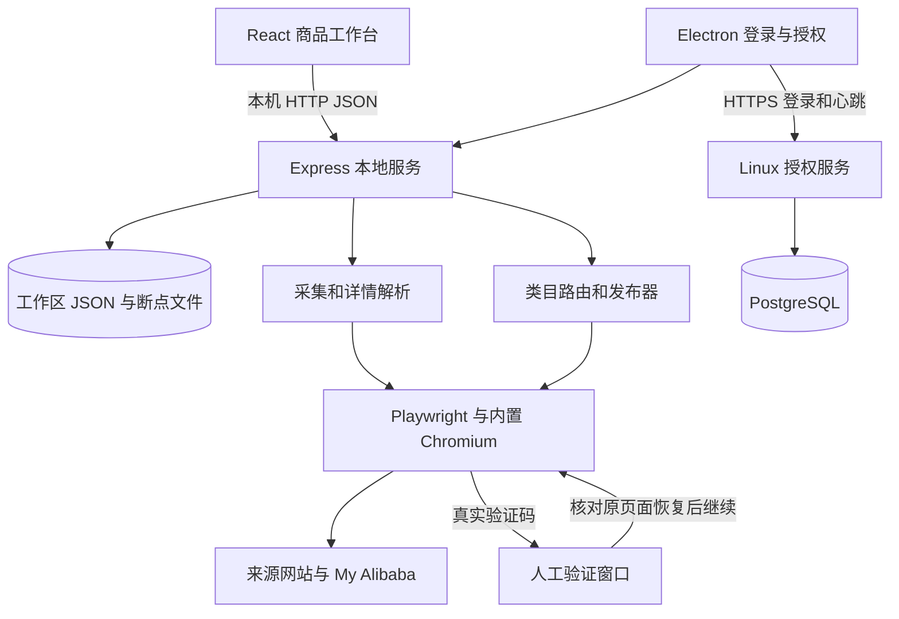

# 抄得快 · 阿里巴巴国际站商品工作台

**1.4.18 修复分支说明：** `codex/fix-posting-overlays-1.4.18` 修复详情表格工具条被误判为弹窗的问题，[修复与真实验证记录](docs/verification-1.4.18.md)。下文 `Stable` 链接和备份教程继续对应完整的 1.4.17 归档；构建当前修复分支时，输出版本为 `1.4.18`。

**Stable 分支：1.4.17。** Windows 桌面客户端，提供国际站、1688、速卖通商品采集、资料编辑、引用成功商品、批量保存草稿与提交上架。授权管理后台部署在 Linux 服务器。

客户端通过 Playwright 操作真实浏览器页面，不是 Alibaba 官方发布 API。验证码需要用户完成；平台审核、账号权限和类目必填规则仍由 Alibaba 决定。

## 下载与完整备份

- [Stable 完整源码](https://github.com/chentao6306/alibaba-international-product-workbench/tree/Stable)
- [1.4.17 安装包与加密数据备份](https://github.com/chentao6306/alibaba-international-product-workbench/releases/tag/v1.4.17-stable)
- [1.4.17 修复和验证记录](docs/verification-1.4.17.md)
- [备份范围、解密和恢复说明](docs/stable-backup.md)
- [Stable 源码与备份核查记录](docs/stable-1.4.17-audit.md)

此分支包含前端、本地服务、Electron 桌面端、授权服务器、数据库结构、管理页面、部署脚本、测试、静态资源与锁定依赖清单。`build/installer.nsh` 是构建源码，必须保留。

Release 另存安装包和加密数据备份，覆盖项目本地数据、当前桌面用户数据、商品/任务/图片、服务器数据库和实际部署配置。密码、Cookie、环境变量等仅位于加密备份，解密密钥由项目所有者在 GitHub 之外保管。

`node_modules`、`dist`、`.packaged`、`vendor/chromium` 是可再生成依赖或构建输出，不直接进入 Git 历史；通过锁定依赖和下文命令恢复，发行 EXE 已包含依赖和浏览器。备份清单会列出未纳入的运行时锁文件等例外。源码和数据备份不是整台 Windows 系统镜像。

## 环境要求

| 项目 | 要求 |
| --- | --- |
| 桌面开发/打包 | Windows 10/11 x64，Git，Node.js 22 LTS，npm 10+ |
| 资源 | 建议 8 GB 以上内存，首次安装/打包预留至少 8 GB 磁盘 |
| 浏览器 | 与锁定 Playwright Core 匹配的 Chromium，按下文下载 |
| 授权服务器 | Linux、Node.js 22、PostgreSQL、Nginx、有效 HTTPS 证书 |
| 业务使用 | 网络可访问 Alibaba，有发布权限的卖家账号、有效软件授权码 |

版本以 `package.json` 和 `package-lock.json` 为准：Electron 44.3.0、Playwright Core 1.62.1、React 19、Vite 6、Express 5、Sharp 0.35.4、SheetJS 0.20.3。不要删除锁文件后任意升级依赖。

## 从 GitHub 首次启动

以下命令在 Windows PowerShell 执行。私有仓库需要已获授权的 GitHub SSH 身份。

```powershell
git clone --branch Stable git@github.com:chentao6306/alibaba-international-product-workbench.git
cd alibaba-international-product-workbench
node --version
npm --version
npm ci

# 使用已锁定的 playwright-core CLI，避免另下载不同版本的 Playwright
node node_modules/playwright-core/cli.js install chromium
npm run prepare:chromium
npm run build
npm run desktop
```

`prepare:chromium` 将对应 revision 的 Chromium 复制到 `vendor/chromium`。自备同版本浏览器时可先设置 `$env:KUA_YIPU_CHROMIUM_SOURCE='D:/browsers/chrome-win64'`，目录内必须有 `chrome.exe`。

桌面版先显示登录和授权码窗口。成功后进入工作台，数据保存在 `%APPDATA%\alibaba-international-product-workbench`。已安装 EXE 的日常使用直接打开“抄得快”快捷方式，不需要 Node.js。

## 日常启动和开发

所有 npm 命令均在仓库根目录执行。

| 场景 | 命令 | 地址/结果 |
| --- | --- | --- |
| 源码桌面日常启动 | `npm run desktop` | Electron 窗口，使用现有 `dist` |
| 浏览器版日常启动 | `npm start` | `http://127.0.0.1:8787` |
| 前后端开发 | `npm run dev` | Vite `5173`，API `8787` |
| 开发服务与桌面壳 | `npm run desktop:dev` | 桌面仍需已有 `dist`，Vite 热更新在 `5173` |
| 重新构建前端 | `npm run build` | `dist/` |
| 全部测试 | `npm test -- --test-concurrency=2` | 降低同时运行浏览器测试的内存竞争 |
| 本地授权后台预览 | `node auth-server/dev.js` | `http://127.0.0.1:8790`，仅开发 |

桌面界面更改后需 `npm run build` 并重新打开桌面端。`start.bat` 会按需安装依赖、构建并启动浏览器版；`dev.bat` 启动开发服务。关闭命令窗口或按 `Ctrl+C` 停止对应服务。

更新 Stable 后：

```powershell
git switch Stable
git pull --ff-only origin Stable
npm ci
node node_modules/playwright-core/cli.js install chromium
npm run prepare:chromium
npm run build
npm run desktop
```

同一工作区不要同时运行多个桌面或后端实例。浏览器版数据默认为仓库 `.data`，与桌面用户目录不同；浏览器开发入口不等同于正式桌面授权入口。

## 生成 Windows EXE

首次先完成 `npm ci` 和 Chromium 下载。确认 `package.json` 与锁文件版本均为 `1.4.17`，然后执行：

```powershell
npm test -- --test-concurrency=2
npm run dist:win:installer
```

输出：`release-installer/chaodekuai-1.4.17-setup.exe`。脚本依次构建前端、准备 Chromium，再执行 Electron Builder NSIS x64 打包。安装包支持选择安装目录、桌面和开始菜单快捷方式。

```powershell
npm run dist:win:portable   # 便携 EXE，输出在 release/
npm run dist:win            # 按 package.json 构建 Windows 目标
```

Electron 下载失败但 `node_modules/electron/dist` 已完整时，可指定本地分发目录：

```powershell
npm run build
npm run prepare:chromium
npx electron-builder --win nsis --x64 `
  --config.electronDist=node_modules/electron/dist `
  --config.directories.output=release-installer `
  '--config.artifactName=chaodekuai-${version}-setup.${ext}' `
  --publish never
```

`beforePack` 运行 `tools/prepare-package.mjs`，从 `server/` 和 `electron/` 生成 `.packaged/`。不要手工修改生成目录或用旧输出代替缺失源码。程序必须包含 `resources/chromium/chrome.exe`。

交付前检查：

```powershell
node tools/desktop-package-qa.mjs release-installer
npx electron tools/verification-window-qa.mjs .packaged/electron/human-verification.js
Get-Item .\release-installer\chaodekuai-1.4.17-setup.exe
Get-FileHash .\release-installer\chaodekuai-1.4.17-setup.exe -Algorithm SHA256
```

包检查核对版本、打包源码、浏览器、安全开关、登录窗口和未登录 API 鉴权，使用隔离用户目录。当前 EXE 未配置 Authenticode 签名；有证书后按 Electron Builder 签名配置构建。`publish` 地址是占位配置，目前通过 GitHub Release 手工分发，没有启用可用的自动更新服务。

打包文件占用时退出对应旧程序和安装器，再使用新的输出目录。安装临时目录写入异常可用 `tools/install-with-local-temp.cmd` 选择本机可写目录，无需关闭杀毒软件。

## 授权服务器部署

完整代码位于 [`auth-server/`](auth-server/README.md)，与客户端共用根目录依赖清单。包括生产入口、安全模块、PostgreSQL 增量结构、管理员初始化、后台页面、Dockerfile 与运维脚本。

首次部署、systemd、HTTPS、管理员初始化和数据库恢复的逐步命令见 [服务器部署教程](auth-server/README.md)。现有服务器常用命令：

```bash
sudo systemctl status kua-yipu-auth --no-pager
sudo journalctl -u kua-yipu-auth -n 100 --no-pager
curl --fail http://127.0.0.1:8790/health
sudo systemctl restart kua-yipu-auth
```

正式客户端授权入口由 `server/auth-endpoint.js` 固定。源码桌面可用 `KUA_YIPU_AUTH_URL` 指向本机开发后台；**正式打包客户端忽略此环境变量**。迁移生产地址需要修改该模块默认地址、配置对应有效证书并重新打包。仅设置打包终端环境变量不能改变正式入口。

授权服务 `/health` 中的版本为 `1.4.9`，代表独立授权协议实现；桌面版本为 `1.4.17`。线上实际运行模块已与本分支核对。后台可配置 1/3/15 天等断线保持时间，不延长付费授权到期日，在线停用仍立即生效。

## 项目原理



1. **采集**：解析列表、分页和类目，逐页保存下一页地址和链接队列。每件详情保存后推进断点，暂停、重启或验证码后接续未完成位置。1.4.17 之前未记录的列表断点不能从旧计数还原。
2. **数据模型**：保存不可变来源快照、可编辑工作副本、发布执行快照。来源 SHA-256 指纹和修改记录用于核查。完整度分数不是上架成功率。
3. **引用**：明确选择成功商品后替换类目、属性、规格选项/图片、SKU 编码/数量/启用状态，补齐缺失包装资料。保留目标标题、售价、主图和详情；需要核对模板适用于实际商品。
4. **发布**：按末级类目 ID 打开表单，填写并核对受控控件、主图、普通编辑器详情图、物流、规格和虚拟 SKU 表。收到平台明确成功反馈或成功地址才标记完成；不把不确定提交自动当成失败重发。
5. **进度**：逐件保存成功、失败和剩余数，前端实时更新。暂停保留已完成结果；来源失败、平台拒绝、登录失效有独立错误状态。
6. **验证**：普通页面隐藏，确认真实可见验证码后显示。人工完成不设等待超时，过期可刷新；核对原页面恢复后继续。跨浏览器会话同步失败时保留原浏览器验证状态。
7. **授权**：服务器管理授权、设备、授权码哈希和签名令牌，不接收 Alibaba 密码。客户端按后台策略处理临时断线；到期或撤销则暂停后续工作并保留数据。

本项目依赖网站 DOM。改版、必填项变化、网络和账号权限会影响成功率；生产使用先检查少量草稿，再批量提交。不会自动绕过验证码。

## 目录和数据

| 路径 | 内容 |
| --- | --- |
| `src/`、`index.html`、`public/` | React 界面、入口、静态资源 |
| `server/` | 本地 API、采集、发布、断点、图片处理、模型、存储 |
| `electron/` | 主进程、登录/验证窗口、预加载桥接、授权保持 |
| `auth-server/` | 授权服务、后台、SQL、Docker、部署配置 |
| `test/`、`tools/` | 测试、真实页面验收、构建、维护工具 |
| `assets/`、`build/installer.nsh` | 图标、NSIS 自定义安装逻辑 |
| `docs/` | 验证、完整性、备份说明 |
| `package.json`、`package-lock.json` | 版本、命令、锁定依赖、打包配置 |
| `.data/` | 浏览器版运行数据，进入加密备份 |

桌面数据目录：

```text
%APPDATA%/alibaba-international-product-workbench/
├─ .data/workspace.json             # 商品、店铺、分组、任务、设置
├─ .data/collection-checkpoints/    # 列表和详情断点
├─ .data/media/                     # 用户上传图片
├─ .data/publish-images/            # 发布图片缓存
├─ .data/*-profile/                 # 浏览器持久化配置
├─ .data/announcement-reads.json    # 公告状态
├─ credentials.bin                 # DPAPI 加密账号密码
├─ activation-credentials.bin       # 加密授权码
├─ alibaba-cookies.json             # 加密会话文件
└─ alibaba-storage.json             # 加密网站存储
```

DeepSeek 密钥加密保存在 `.data/integrations.bin`。更换 Windows 用户或电脑后，DPAPI 凭据可能无法解密，需要重新登录并配置密钥；商品和任务 JSON 不受此限制。恢复步骤见 [备份说明](docs/stable-backup.md)。

## 测试与完整性检查

```powershell
npm test -- --test-concurrency=2
npm run build
node tools/reference-ui-qa.mjs
node tools/group-origin-ui-qa.mjs
npx electron tools/verification-window-qa.mjs
```

1.4.17 应用修复通过 186 项自动测试，以及真实草稿、20 行 SKU 核对和一件正式提交。Stable 归档增加加密备份往返/篡改拒绝测试。真实验证码人工完成验收仍按 [验证记录](docs/verification-1.4.17.md) 的未完成项继续，不宣称所有商品百分之百成功。

源站未公开的 SKU 商业数据无法凭空获得，图片链接可能失效，跨类目引用可能带来不适用属性。带 `live`、`publish` 的工具可能操作真实站点，先阅读脚本并使用隔离数据目录。

```powershell
git fetch origin Stable
git rev-parse HEAD
git rev-parse origin/Stable
git diff --exit-code HEAD origin/Stable
git status --short
git ls-tree -r --name-only origin/Stable
```

首次 Stable 归档从已验收的 `65dc255` 建立并保留全部历史。应用源码保持 1.4.17，归档提交补充文档、备份工具和核查记录。Release 的 SHA-256 清单用于下载校验；解密密钥不上传 GitHub。
