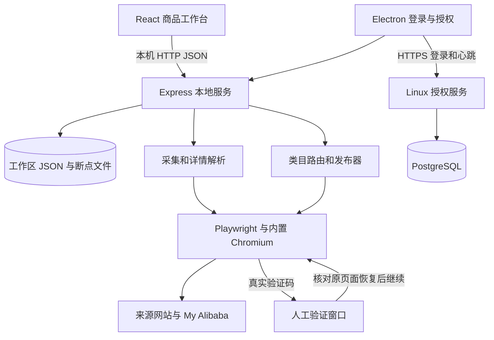

# 抄得快 · 阿里巴巴国际站商品工作台

当前版本：**1.4.58**，更新日期：**2026-10-05**。最新完整源码以默认 **main** 分支为准。

## 常用命令速查

在 Windows PowerShell 的项目根目录执行。首次下载后先安装依赖并准备浏览器：

```powershell
npm ci
node node_modules/playwright-core/cli.js install chromium
npm run prepare:chromium
```

| 操作 | 命令 | 结果 |
| --- | --- | --- |
| 开发前后端 | `npm run dev` | 界面 `http://127.0.0.1:5173`，API `8787` |
| 构建前端 | `npm run build` | 输出 `dist/` |
| 启动完整桌面版 | `npm run desktop` | 先构建前端，桌面端自动启动本地服务 |
| 启动浏览器版 | `npm start` | 先构建前端，打开 `http://127.0.0.1:8787` |
| 运行全部测试 | `npm test` | 部分用例会启动内置 Chromium |
| 减少测试并发 | `npm test -- --test-concurrency=2` | 减少浏览器同时运行数量 |
| 生成安装版 EXE | `npm run dist:win:installer` | `release-installer/chaodekuai-1.4.58-setup.exe` |
| 生成便携版 EXE | `npm run dist:win:portable` | `release/chaodekuai-1.4.58-win-x64.exe` |
| 启动官网开发预览 | `npm run website:dev` | `http://127.0.0.1:5175/website/` |
| 构建官网 | `npm run website:build` | 独立输出 `dist-website/` |
| 预览官网成品 | `npm run website:preview` | `http://127.0.0.1:4175/website/` |

最常用：改代码用 `npm run dev`；测试桌面端先 `npm run build` 再 `npm run desktop`；给客户打包用 `npm run dist:win:installer`。

## 在线更新和管理员发布

官网源码在 `website/`，支持电脑和手机浏览，包含功能介绍、入门指南、软件下载及微信二维码。无需域名，可部署到现有服务器 `https://服务器IP/website/`。官网安装包与桌面更新共用后台“系统更新”：上传签名安装包并正式发布后自动同步；草稿不公开，撤回最新版本会停止官网下载。固定下载入口每次获取当前正式版，不依赖写死的版本文件。启动、部署、客服配置及验证见 [官网说明](website/README.md)。

1.4.53 新增“设置 → 软件更新”：显示版本与更新说明、自动检查、下载进度、断点续传、退出后安装。正在执行任务或保存资料时不会开始安装。低于 1.4.53 的旧客户端需要先手动安装一次当前版本，以后可在软件中更新。

授权管理后台使用左侧可折叠菜单，分为授权管理、软件管理和内容管理；子菜单可直接进入新增授权、系统更新、版本记录与公告编辑。系统更新页上传 EXE 和配套 `.exe.update.json`，填写标题和说明，保存草稿后在版本记录中正式发布。每条记录显示完整说明、状态、文件大小和时间，可编辑说明、停止分发、下载安装包。支持上传暂停和续传。打包命令自动生成两个文件，**不要发送 `inner.exe`**。

2026-10-03 已部署后台排版和上传修复：修复 Nginx 重定向使上传请求变为列表请求、触发 `reading 'size'` 报错的问题。刷新后台即可使用，后台此次更新不需要重装客户端；已有 1.4.54 安装包与签名文件可继续上传。验证和界面截图见 [后台更新验证](docs/admin-update-layout-2026-10-03.md)。

安装中断恢复、签名私钥备份、后台部署和完整发布流程见 [在线更新说明](docs/software-updates.md)。此版本同时修复重复文本控件把多个 OE 代码拼到第一行的问题，逐行填写并回读校验；未取得客户实际商品，真实商品需客户重试确认。

## 登录错误提示与账号校验

1.4.54 保持登录失败时关闭阿里窗口，并在软件登录页显示阿里巴巴实际提示、加载失败或超时原因。账号密码被拒绝后，返回软件修改再重新验证授权；自动填写会等待可见表单，核对两个输入值后只提交一次。验证码仍需人工完成，账号不一致不允许进入软件，进入前再次核对实际登录账号。阿里已拒绝的记住密码会清除；人工完成的登录不会把未验证的原密码重新保存。

## 当前功能与验证

- 类目目录浏览、搜索和末级类目选择；成功商品的类目、属性和规格引用。
- 主图和详情图上传、单张/批量删除；文字和上传图片水印均支持范围、位置、大小和透明度，更新不叠加，保存后可移除软件水印恢复底图。
- 原图水印框选修复与预览，适合简单背景；客户可维护多套公司详情模板，批量替换、前置或追加。
- 修复必填/选填缺失属性首次输入后失焦问题，支持已知下拉、多选项。已验证编辑保存后发布填写新值，并取消旧多选值、清除旧选项 ID。
- 包含此前授权码重置、多端登录、临时断线保持、后台任务线程、产品链接与浏览器窗口处理修复。

1.4.58 修复多个品类共用的销售规格处理：按属性 ID、完整名称和已知中英文别名识别目标控件，区分普通颜色、灯光颜色与镜片颜色，支持直接显示的必填规格。文本、下拉、单选、多选和图片规格复用各自的控件处理，回读完整值集合；SKU 行按实际目标名称与选项关联，避免规格译名不同导致价格、库存错配。已保存的图片规格值可直接使用，本次四件车灯商品不需要重新采集。完整测试 532/532 通过。验证范围和真实页面限制见 [1.4.58 验证记录](docs/verification-1.4.58.md)。

1.4.57 修复汽车灯具类目发布重试：采集到的英文 `Purpose`、`Car Model`、`Voltage`、`Condition`、`Lumens`、`Color Temperature` 会映射到国际站对应的中文必填属性；OE 代码支持国际站没有下拉选项的可输入组合框，填写后触发提交事件并回读确认。已有商品无需重新采集，修复后可直接重试。完整测试 525/525 通过。

1.4.56 修复编辑保存草稿和发布时的属性映射：OE 代码支持 `OE Number`、`OE Code`、`OEM Number` 等来源名称，即使来源和目标页面重新生成了不同属性 ID 也会填入目标 `OE代码`；商品规格按目标发布页实际显示的 `规格`、`Specification`、`型号` 等销售属性匹配，不再只依赖来源 ID，确保保存草稿时规格选项和值一起写入。普通属性仍保留 ID 校验，避免把用途、特征等同名字段误填。新增跨语言和跨 ID 回归测试，完整测试 524/524 通过。

1.4.55 修复主图仅部分接收后直接停止的问题：最多尝试三次，保留已接收图片，只补传缺失部分并复核顺序。运行中的批量上架遇到单件图片、控件、类目、表单或登录错误，记录该件失败后继续下一件，不再自动暂停整批。提交结果不明确时标记“待核对”，本轮不重复提交；用户手动暂停继续保留位置。验证码仍由用户完成，软件授权失效及程序退出/重启的保护机制保留。详见 [1.4.55 验证记录](docs/verification-1.4.55.md)。

已有商品无需删除或重新采集，修改保存后再重试发布。登录修复见 [1.4.54 验证记录](docs/verification-1.4.54.md)，在线更新验证见 [1.4.53 验证记录](docs/verification-1.4.53.md)；历史功能见 [1.4.52 验证记录](docs/verification-1.4.52.md)。

采集列表中途暂停后，点击“采集已发现的 N 件商品”即可停止继续翻页、转为读取这些商品的详情；点击原来的继续按钮则接着翻页。详情采集仍支持断点继续。上架时类目失效、控件重试失败等错误会显示在对应商品上，剩余商品继续处理；结束后可修正失败商品再重试。上架只使用已保存资料，不再自动访问来源商品页；需要更新来源资料时，在商品工作台主动重新采集。

Windows 桌面客户端，提供国际站、1688、速卖通商品采集、资料编辑、引用成功商品、批量保存草稿与提交上架。授权管理后台部署在 Linux 服务器。下载、开发和构建均使用 `main` 分支。

客户端通过 Playwright 操作真实浏览器页面，不是 Alibaba 官方发布 API。验证码需要用户完成；平台审核、账号权限和类目必填规则仍由 Alibaba 决定。

## 源码与备份范围

- [当前 1.4.58 完整源码](https://github.com/chentao6306/alibaba-international-product-workbench/tree/main)
- [1.4.52 修复和验证记录](docs/verification-1.4.52.md)
- [备份范围、解密和恢复说明](docs/stable-backup.md)

此分支包含前端、本地服务、Electron 桌面端、授权服务器、数据库结构、管理页面、部署脚本、测试、静态资源与锁定依赖清单。`build/installer.nsh` 是构建源码，必须保留。

源码仓库不包含客户商品、任务、浏览器登录资料或生产环境配置；这些数据需单独备份。本次只同步源码，不上传安装包或运行数据。历史备份的日期、范围和恢复方式以对应备份说明为准，不代表最新用户数据已备份。

`node_modules`、`dist`、`.packaged`、`vendor/chromium` 是可再生成依赖或构建输出，不提交到源码仓库；通过锁定依赖和下文命令恢复，发行 EXE 已包含依赖和浏览器。

## 环境要求

| 项目 | 要求 |
| --- | --- |
| 桌面开发/打包 | Windows 10/11 x64，Git，Node.js 22 LTS，npm 10+ |
| 资源 | 建议 8 GB 以上内存，首次安装/打包预留至少 8 GB 磁盘 |
| 浏览器 | 与锁定 Playwright Core 匹配的 Chromium，按下文下载 |
| 授权服务器 | Linux、Node.js 22、PostgreSQL、Nginx、有效 HTTPS 证书 |
| 业务使用 | 网络可访问 Alibaba，有发布权限的卖家账号、有效软件授权码 |

版本以 `package.json` 和 `package-lock.json` 为准：Electron 44.3.0、Playwright Core 1.62.1、React 19、Vite 6、Express 5、Sharp 0.35.4、SheetJS 0.20.3。不要删除锁文件后任意升级依赖。

## 从 GitHub 首次启动

以下命令在 Windows PowerShell 执行。私有仓库需要已获授权的 GitHub SSH 身份。

```powershell
git clone --branch main git@github.com:chentao6306/alibaba-international-product-workbench.git
cd alibaba-international-product-workbench
node --version
npm --version
npm ci

# 使用已锁定的 playwright-core CLI，避免另下载不同版本的 Playwright
node node_modules/playwright-core/cli.js install chromium
npm run prepare:chromium
npm run build
npm run desktop
```

`prepare:chromium` 将对应 revision 的 Chromium 复制到 `vendor/chromium`。自备同版本浏览器时可先设置 `$env:KUA_YIPU_CHROMIUM_SOURCE='D:/browsers/chrome-win64'`，目录内必须有 `chrome.exe`。

桌面版先显示登录和授权码窗口。成功后进入工作台，数据保存在 `%APPDATA%\alibaba-international-product-workbench`。已安装 EXE 的日常使用直接打开“抄得快”快捷方式，不需要 Node.js。

## 日常启动和开发

所有 npm 命令均在仓库根目录执行。

| 场景 | 命令 | 地址/结果 |
| --- | --- | --- |
| 源码桌面日常启动 | `npm run desktop` | Electron 窗口，使用现有 `dist` |
| 浏览器版日常启动 | `npm start` | `http://127.0.0.1:8787` |
| 前后端开发 | `npm run dev` | Vite `5173`，API `8787` |
| 重新构建前端 | `npm run build` | `dist/` |
| 全部测试 | `npm test -- --test-concurrency=2` | 降低同时运行浏览器测试的内存竞争 |
| 本地授权后台预览 | `node auth-server/dev.js` | `http://127.0.0.1:8790`，仅开发 |

桌面界面更改后需 `npm run build` 并重新打开桌面端。`start.bat` 会按需安装依赖、构建并启动浏览器版；`dev.bat` 启动开发服务。关闭命令窗口或按 `Ctrl+C` 停止对应服务。

后续获取 `main` 分支更新：

```powershell
git switch main
git pull --ff-only origin main
npm ci
node node_modules/playwright-core/cli.js install chromium
npm run prepare:chromium
npm run build
npm run desktop
```

同一工作区不要同时运行多个桌面或后端实例。桌面版自动启动服务，运行 `npm run desktop` 前先停止 `npm run dev` 或 `npm start`，避免争用 8787 端口。旧 `desktop:dev` 组合脚本会重复启动独立 API，当前桌面开发使用构建后单独启动的方式。浏览器版数据默认为仓库 `.data`，与桌面用户目录不同；浏览器开发入口不等同于正式桌面授权入口。

## 销售方式与默认库存

上架任务默认使用“自动判断（推荐）”：按当前页面和可用资料逐件决定。有完整资料时填写物流；资料不足、当前页面明确是商机品且物流可选时，按询盘展示发布。显式设置过的销售方式和旧任务设置保留。也可直接选择“询盘展示（商机品）”或“填写完整物流资料”。询盘展示将已采集的包装重量、尺寸保留到英文详情表格，商品工作台的原始包装资料也保留。仅在发布页明确显示商机品且物流字段可选时，才留空交易运输设置；不会把电池、液体、磁性商品统一标为普货。完整物流方式统一核对当前页面的包装、实际物流属性和运费设置；全部留空也会提示待补充，不能靠删除真实资料跳过检查。运行结果记录请求方式、实际方式和自动判断原因。填写完整物流本身不负责将商机品转换成交易品。

设置中的“来源未公开库存时”默认按商品起订量生成可售数量，也可选固定默认库存。来源真实库存、手工修改的库存、零库存和停用 SKU 保留；默认值有单独来源标记，不当作来源站实际库存。旧数据仅在来源快照和修改记录可确认时替换历史默认 100。销售方式与库存规则写入任务。暂停后可手动调整剩余商品的销售方式，再点击继续；未调整时保留原设置，成功商品不会重新发布，库存规则保持不变。

## 生成 Windows EXE

首次先完成 `npm ci` 和 Chromium 下载。确认 `package.json` 与锁文件版本均为 `1.4.58`，然后执行：

```powershell
npm test -- --test-concurrency=2
npm run dist:win:installer
```

输出：`release-installer/chaodekuai-1.4.58-setup.exe`。脚本依次构建前端、准备 Chromium，再执行 Electron Builder NSIS x64 打包。安装包支持选择安装目录、桌面和开始菜单快捷方式。

```powershell
npm run dist:win:portable   # release/chaodekuai-1.4.58-win-x64.exe
npm run dist:win            # 按 package.json 构建 Windows 目标
```

Electron 下载失败但 `node_modules/electron/dist` 已完整时，可指定本地分发目录：

```powershell
npm run build
npm run prepare:chromium
npx --no-install electron-builder --win nsis --x64 `
  --config.electronDist=node_modules/electron/dist `
  --config.directories.output=release-installer `
  '--config.artifactName=chaodekuai-${version}-inner.${ext}' `
  --publish never
node tools/build-setup.mjs
node tools/verify-update-package.mjs release-installer
```

便携版仍会在 Windows 用户目录保存商品、任务和登录资料。下次版本升级可用 `npm version 1.4.59 --no-git-tag-version` 同步清单与锁文件，再测试打包；此命令只是升级示例，不是运行当前版本的必要步骤。

`beforePack` 运行 `tools/prepare-package.mjs`，从 `server/` 和 `electron/` 生成 `.packaged/`。不要手工修改生成目录或用旧输出代替缺失源码。程序必须包含 `resources/chromium/chrome.exe`。

交付前检查：

```powershell
node tools/desktop-package-qa.mjs release-installer
npx --no-install electron tools/verification-window-qa.mjs .packaged/electron/human-verification.js
Get-Item .\release-installer\chaodekuai-1.4.58-setup.exe
Get-FileHash .\release-installer\chaodekuai-1.4.58-setup.exe -Algorithm SHA256
```

包检查核对版本、打包源码、浏览器、安全开关、登录窗口和未登录 API 鉴权，使用隔离用户目录。当前 EXE 未配置 Authenticode 签名；有证书后按 Electron Builder 签名配置构建。软件在线更新使用本项目的签名与授权后台分发服务；不要把 Electron Builder 的 `publish` 占位地址当作线上更新源。正式打包请运行 `npm run dist:win:installer`，以生成完整的外层安装包和配套更新签名。

打包文件占用时退出对应旧程序和安装器，再使用新的输出目录。安装临时目录写入异常可用 `tools/install-with-local-temp.cmd` 选择本机可写目录，无需关闭杀毒软件。

## 授权服务器部署

完整代码位于 [`auth-server/`](auth-server/README.md)，与客户端共用根目录依赖清单。包括生产入口、安全模块、PostgreSQL 增量结构、管理员初始化、后台页面、Dockerfile 与运维脚本。

首次部署、systemd、HTTPS、管理员初始化和数据库恢复的逐步命令见 [服务器部署教程](auth-server/README.md)。现有服务器常用命令：

```bash
sudo systemctl status kua-yipu-auth --no-pager
sudo journalctl -u kua-yipu-auth -n 100 --no-pager
curl --fail http://127.0.0.1:8790/health
sudo systemctl restart kua-yipu-auth
```

正式客户端授权入口由 `server/auth-endpoint.js` 固定。源码桌面可用 `KUA_YIPU_AUTH_URL` 指向本机开发后台；**正式打包客户端忽略此环境变量**。迁移生产地址需要修改该模块默认地址、配置对应有效证书并重新打包。仅设置打包终端环境变量不能改变正式入口。

授权服务 `/health` 中的版本为 `1.4.53`，是独立服务标识；当前桌面版本为 `1.4.58`。后台可配置 1/3/15 天等断线保持时间，不延长付费授权到期日，在线停用仍立即生效。2026-10-03 的后台菜单、版本记录和上传修复已部署，1.4.58 的规格映射修复需要更新客户端，不需要再次部署授权服务。

## 项目原理



1. **采集**：解析列表、分页和类目，逐页保存下一页地址和链接队列。每件详情保存后推进断点，暂停、重启或验证码后接续未完成位置。1.4.17 之前未记录的列表断点不能从旧计数还原。
2. **数据模型**：保存不可变来源快照、可编辑工作副本、发布执行快照。来源 SHA-256 指纹和修改记录用于核查。完整度分数不是上架成功率。
3. **引用**：明确选择成功商品后替换类目、属性、规格选项/图片、SKU 编码/数量/启用状态，补齐缺失包装资料。保留目标标题、售价、主图和详情；需要核对模板适用于实际商品。
4. **发布**：按末级类目 ID 打开表单，填写并核对受控控件、主图、普通编辑器详情图、物流、规格和虚拟 SKU 表。收到平台明确成功反馈或成功地址才标记完成；不把不确定提交自动当成失败重发。
5. **进度**：逐件保存成功、失败和剩余数，前端实时更新。暂停保留已完成结果；来源失败、平台拒绝、登录失效有独立错误状态。
6. **验证**：普通页面隐藏，确认真实可见验证码后显示。人工完成不设等待超时，过期可刷新；核对原页面恢复后继续。跨浏览器会话同步失败时保留原浏览器验证状态。
7. **授权**：服务器管理授权、设备、授权码哈希和签名令牌，不接收 Alibaba 密码。客户端按后台策略处理临时断线；到期或撤销则暂停后续工作并保留数据。

本项目依赖网站 DOM。改版、必填项变化、网络和账号权限会影响成功率；生产使用先检查少量草稿，再批量提交。不会自动绕过验证码。

## 目录和数据

| 路径 | 内容 |
| --- | --- |
| `src/`、`index.html`、`public/` | React 界面、入口、静态资源 |
| `server/` | 本地 API、采集、发布、断点、图片处理、模型、存储 |
| `electron/` | 主进程、登录/验证窗口、预加载桥接、授权保持 |
| `auth-server/` | 授权服务、后台、SQL、Docker、部署配置 |
| `test/`、`tools/` | 测试、真实页面验收、构建、维护工具 |
| `assets/`、`build/installer.nsh` | 图标、NSIS 自定义安装逻辑 |
| `docs/` | 验证、完整性、备份说明 |
| `package.json`、`package-lock.json` | 版本、命令、锁定依赖、打包配置 |
| `.data/` | 浏览器版运行数据，不提交到 Git，需单独备份 |

桌面数据目录：

```text
%APPDATA%/alibaba-international-product-workbench/
├─ .data/workspace.json             # 商品、店铺、分组、任务、设置
├─ .data/collection-checkpoints/    # 列表和详情断点
├─ .data/media/                     # 用户上传图片
├─ .data/publish-images/            # 发布图片缓存
├─ .data/*-profile/                 # 浏览器持久化配置
├─ .data/announcement-reads.json    # 公告状态
├─ credentials.bin                 # DPAPI 加密账号密码
├─ activation-credentials.bin       # 加密授权码
├─ alibaba-cookies.json             # 加密会话文件
└─ alibaba-storage.json             # 加密网站存储
```

DeepSeek 密钥加密保存在 `.data/integrations.bin`。更换 Windows 用户或电脑后，DPAPI 凭据可能无法解密，需要重新登录并配置密钥；商品和任务 JSON 不受此限制。恢复步骤见 [备份说明](docs/stable-backup.md)。

## 测试与完整性检查

```powershell
npm test -- --test-concurrency=2
npm run build
node tools/product-attributes-qa.mjs
node tools/image-watermark-qa.mjs
node tools/product-image-qa.mjs
node tools/product-editor-qa.mjs
npx --no-install electron tools/verification-window-qa.mjs
```

1.4.52 已通过前端构建、上述属性/图片/商品编辑 UI 验证和安装包核验。两次全量测试各为 487 项通过、1 项超时取消；两个曾超时的测试文件随后单独串行运行，8 项全部通过。没有将全量结果记为一次全绿。详细结果见 [验证记录](docs/verification-1.4.52.md)。

属性发布验证使用编辑 UI、真实保存 API 和生产发布填写函数，目标是隔离的受控表单；没有向客户店铺提交商品，也不代表所有国际站类目均已逐一实测。

源站未公开的 SKU 商业数据无法凭空获得，图片链接可能失效，跨类目引用可能带来不适用属性。带 `live`、`publish` 的工具可能操作真实站点，先阅读脚本并使用隔离数据目录。

```powershell
git fetch origin main
git rev-parse HEAD
git rev-parse origin/main
git diff --exit-code HEAD origin/main
git status --short
git ls-tree -r --name-only origin/main
```

`main` 中只保留当前实现及仍有用的测试、构建工具和文档。历史验证记录用于追溯，Git 提交历史用于恢复，不是另一份需要运行的旧源码。下载最新代码时无需切换历史版本分支。
