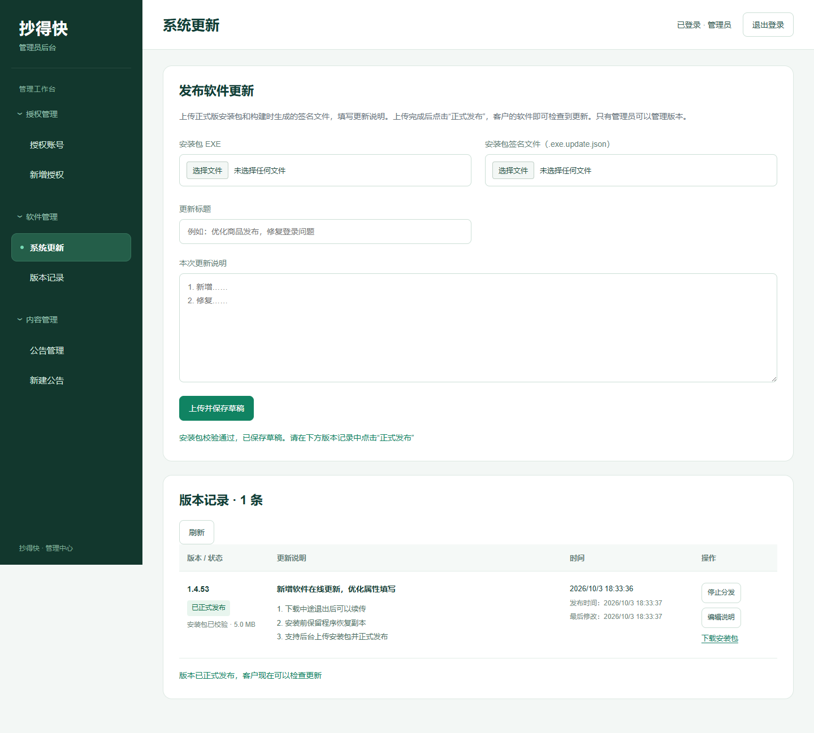
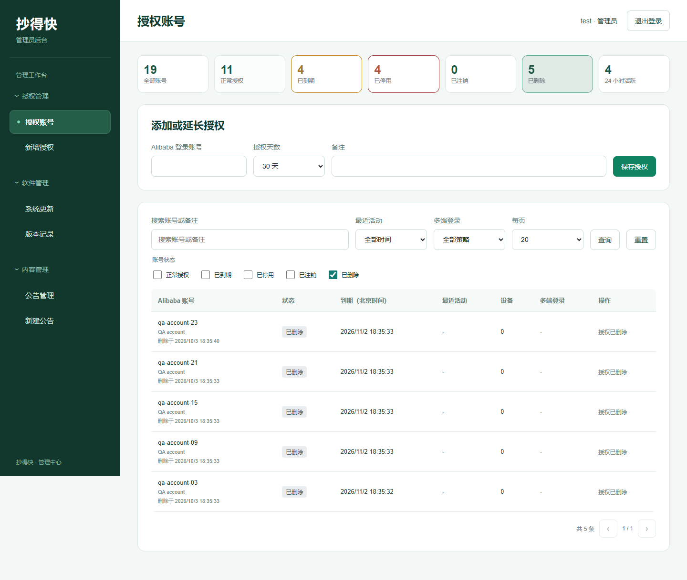
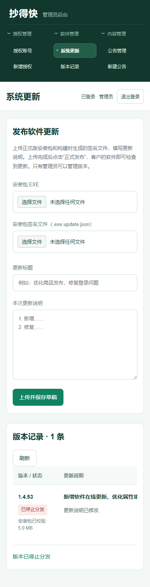

# 管理后台排版与更新上传修复 · 2026-10-03

此次只修改管理后台和更新服务，桌面客户端保持 1.4.54；无需重新生成安装包。原 1.4.54 EXE 与配套 `.exe.update.json` 可继续使用。

## 上传报错原因

生产 Nginx 仅配置了带斜杠的 `/api/admin/updates/` 代理。旧网页向不带斜杠的集合地址发送 POST，Nginx 返回 301，浏览器将请求改为 GET，得到版本列表；随后网页将列表当成单个版本访问 `artifact.size`，触发截图中的异常。

- 补充精确集合路由，保留旧网页和带斜杠分块路由兼容。
- 新网页统一使用带斜杠地址，拒绝重定向，并校验返回的版本对象、签名大小和上传偏移。
- 错误显示中文原因，已上传内容可以继续上传；不会把异常响应当成上传成功。

## 管理界面

- 左侧三个可折叠分组：授权管理、软件管理、内容管理。各组下提供授权账号、新增授权、系统更新、版本记录、公告管理和新建公告子菜单。
- 顶部显示当前页面、管理员和退出按钮，右侧按卡片组织表单与记录；手机上菜单移到顶部，表单单列，宽表在卡片内横向滚动。
- 上传卡片分为 EXE、签名文件、更新标题和说明，上传时显示进度及暂停按钮。
- 版本记录按版本/状态、完整说明、时间和操作分列。已校验草稿可正式发布；已发布版本可停止分发，所有记录可编辑说明，未完成记录可继续上传。
- 已校验草稿和撤回包只允许管理员下载；已发布包继续通过公开分发地址供客户端续传。
- 保留旧版已发布记录的说明编辑能力，仍禁止撤回旧版后越过较新版本重新发布。

## 验证

| 检查 | 结果 |
| --- | --- |
| `npm test -- --test-concurrency=2` | 518 通过，0 失败、取消、跳过 |
| `node --test test/software-updates.test.js test/update-proxy.test.js` | 14 通过 |
| `node tools/updates-ui-qa.mjs` | 本地真实更新路由及浏览器流程通过 |
| `node tools/admin-qa.mjs` | 左侧分组展开/收起、快捷入口、账号授权和公告回归通过 |
| 1440 像素桌面及 390 像素手机截图检查 | 布局正常，手机无整页水平溢出 |
| 生产 Nginx 配置与健康 | `nginx -t` 通过，服务 active，`/health` 正常 |
| 生产文件一致性 | HTML、JS、CSS 和更新模块 SHA-256 与本地一致 |
| 生产集合路由 | 带/不带末尾斜杠的未登录 POST 均返回 401，没有 301 |
| 生产管理员安装包下载 | 未登录返回 401 |

上传界面测试使用隔离的测试管理员、临时签名密钥及 5 MB 测试文件：模拟旧 Nginx 的补斜杠行为；注入不正确的数组响应以检查友好错误；在第 2 个分块暂停，再从服务器记录的偏移继续；完成草稿下载、正式发布、编辑说明与停止分发。浏览器没有页面脚本错误。还验证了客户端检查、下载与暂停现有流程。

生产未使用保存的管理员凭据、未创建/发布/撤回真实版本，也未上传测试安装包。线上验证限于部署内容、健康、路由和未登录鉴权；实际 1.4.54 安装包由管理员在刷新后的页面选择并上传。

## 部署与恢复

2026-10-03 已部署现有 HTTPS 管理后台。路由修改先备份并检查配置，再重载 Nginx。后台部署使用 `auth-server/deploy/update-admin.sh`，只替换五个源文件，备份原文件并检查重启后健康，不迁移数据库，不修改授权、会话、公告或版本目录。

- Nginx 配置备份：`/var/backups/kua-yipu-update-route-20261003182216.conf`。
- 管理后台代码备份：`/var/backups/kua-yipu-admin-20261003183833`。
- 更新包与版本目录保持在 `/var/lib/kua-yipu/updates`。

刷新后台即可使用；旧缓存可通过 `Ctrl+F5` 刷新。发布操作和增量部署命令见 [在线更新说明](software-updates.md)。

## 界面截图（隔离测试数据）

