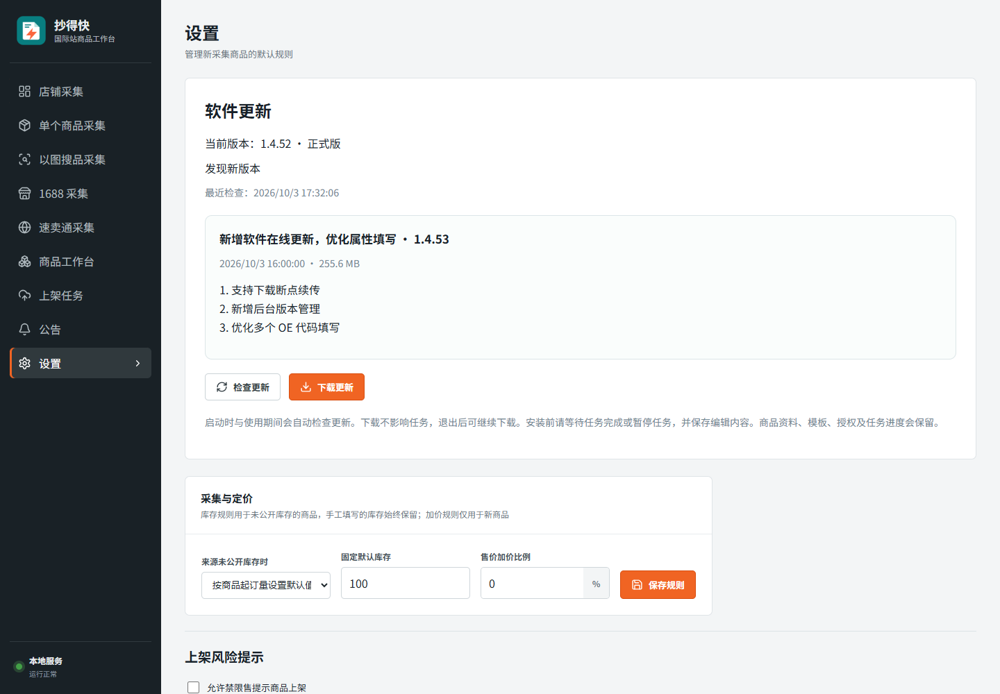
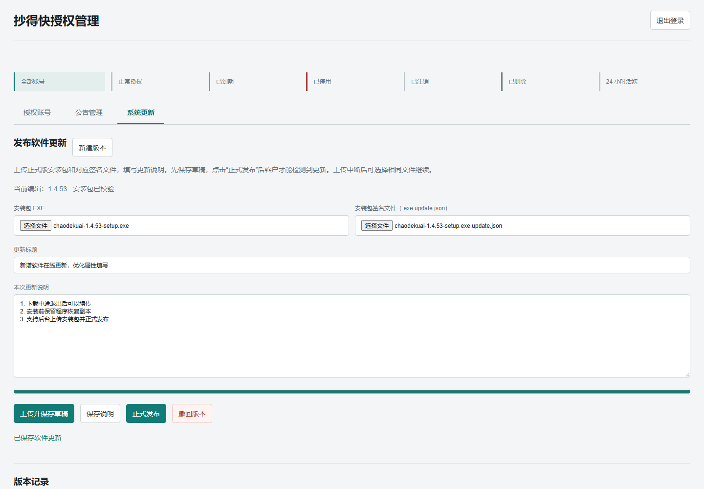

# 1.4.53 验证记录

日期：2026-10-03。

## 修改

- 设置页新增正式版检查、更新说明、下载进度、取消/续传、退出并安装。
- Ed25519 签名 + SHA-256 + 大小校验，拒绝被篡改或错误产品的包；安装前重新校验并检查发布状态。
- 原授权后台新增版本管理：分块上传/续传、草稿、正式发布、修改说明、撤回。
- 安装独立于桌面进程，准备就绪后才退出；任务或保存仍在进行时不允许安装。旧程序副本、持久恢复标记、安装结果记录保留在独立目录；业务数据不迁移。
- 重复文本属性逐项填写。模拟 OE 代码场景在修改前复现了客户截图中的相同错误，修改后可以填写多个编码并清除多余旧值，超长代码仍失败，不伪造或截断后声称成功。

## 验证

| 检查 | 结果 |
| --- | --- |
| `npm test -- --test-concurrency=2` | 498 项，496 通过，1 失败、1 超时取消；构建同时运行时 OE 场景总超时、现有文件选择器场景 1 秒超时 |
| `node --test --test-concurrency=1 test/multi-text-attributes.test.js test/posting-interaction.test.js test/software-updates.test.js` | 独立重跑 25/25 通过，覆盖上述两个超时用例 |
| 最终修改后 `node --test test/multi-text-attributes.test.js test/software-updates.test.js` | 10/10 通过 |
| 属性填写/通用发布/历史回归 | 25/25 通过 |
| `node tools/updates-ui-qa.mjs` | 客户端检查、下载、暂停；真实本地 5 MB 分块上传、草稿不可见、发布、说明修改、撤回均通过，无页面 JS 错误 |
| `node tools/update-recovery-qa.mjs` | 使用实际 Windows C# 恢复代码，模拟安装中途程序文件被覆盖/丢失，旧文件恢复且业务数据哨兵未改变 |
| `npm run build` | 通过；保留现有大 chunk 提示 |
| Windows NSIS + C# 安装包构建 | 通过，生成 EXE 和配套更新签名文件 |
| `node tools/verify-update-package.mjs E:/CodexBuildTemp/chaodekuai-1.4.53` | 包内 74 个源码模块与最终源码转换结果一致；版本、公钥协议、安装包大小、签名与 SHA-256 一致；未混入 .data/.env/私钥 |
| 生产后台部署 | 健康检查 1.4.53；HTTPS 更新目录、后台 JS 正常；未登录访问版本管理返回 401 |

客户端界面截图为模拟版本状态；管理后台截图来自本地完整上传/发布测试，不是生产客户数据：

## 边界

- 客户未提供实际失败商品链接/ID，不能确认客户所有 OE 错误均为重复文本控件导致；没有对客户真实商品进行提交。
- 自动审批拒绝了“启动安装包预检并验证现有管理员凭据”的命令，只返回策略阻止。未执行实际安装覆盖，未登录生产后台；恢复代码测试不等于真实断电测试。
- 生产后台功能已部署，但尚未上传/正式发布首个新版本。应先在维护者电脑试装，再从后台上传 EXE 和 `.exe.update.json` 并正式发布。
- 旧客户端没有更新功能，第一次升级仍需手工安装。

## 交付

- 文件：`chaodekuai-1.4.53-setup.exe`
- 大小：267282432 字节
- SHA-256：`924e9d7476f1491600788989dba530d2ffdda51ffa7120241d40647852ce89e1`
- 交付目录：`D:/抄得快安装包/1.4.53/`，含签名文件和使用说明。
- 服务器源码/数据库备份：`/var/backups/kua-yipu-auth-20261003172253`。
- 更新流程与安装恢复：[软件更新说明](software-updates.md)。
