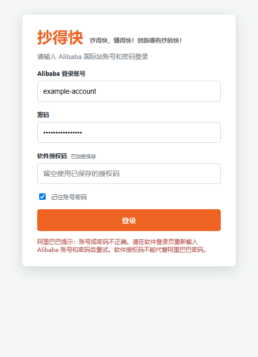

# 1.4.54 登录修复验证

日期：2026-10-03。

## 问题与处理

用户截图中阿里巴巴返回 `Your account name or password is incorrect.`。原代码检测到该提示后关闭窗口，但只向软件登录页返回“登录失败”，丢失实际原因。

- 保持失败时关闭阿里窗口；在软件登录页显示账号密码错误、网络加载失败、授权拒绝、主动取消或超时原因。账号密码错误后由用户返回软件修改，再重新校验软件授权。
- 自动填写等待可见且可用的账号、密码输入框，触发原生输入事件，提交前核对两个值，只在登录路径自动提交一次。隐藏表单、异步重绘和用户输入不会触发错误提交。
- 登录实际账号与授权账号不一致时关闭窗口并拒绝登录；进入工作台前再次读取会话，拒绝已切换、退出或有冲突的账号。阿里页面未通过校验时不显示进入按钮。
- 拒绝同时发起多次登录。窗口关闭或页面导航后，旧的异步检查不能再标记验证成功。
- 已被阿里拒绝的记住密码会清除；人工处理后未确认的原始密码不会再次保存。验证码仍由用户完成，完成后仍校验账号与软件授权。

## 验证

| 检查 | 结果 |
| --- | --- |
| `npm test -- --test-concurrency=2` | 512/512 通过，无失败、取消或跳过 |
| 最终修改后 `node --test test/alibaba-login.test.js test/security.test.js` | 24/24 通过，其中登录专项 15 项 |
| 登录页面检查 | 使用真实 Chromium DOM 和模拟 IPC，错误原因展示完整，登录按钮恢复可用 |
| 前端构建 | 通过；保留现有大 chunk 提示 |
| Windows 安装包构建 | NSIS 与外层安装程序构建通过；初次下载 Electron 网络超时，改用本机已安装的同版本 `node_modules/electron/dist`（44.3.0）完成 |
| `node tools/verify-update-package.mjs E:/CodexBuildTemp/chaodekuai-1.4.54` | 包内 76 个模块与最新源码一致，版本、更新签名、大小与 SHA-256 均一致，未混入运行数据或私钥 |

测试覆盖密码错误立即关闭、中文提示、隐藏错误不误判、延迟表单、输入被重绘清空、单次提交、人工验证码、其他账号拒绝、校验中关闭窗口、真实网络错误与正常重定向、授权拒绝、超时以及软件端错误展示。页面与会话数据均为本地测试样例，没有尝试用户真实密码，也没有访问客户账号。

以下界面为测试样例：

## 验证边界

- 截图能确认阿里拒绝了那次登录，不能单凭截图确定密码确实输错还是自动填写未完成。本次修复保留平台拒绝结果，防止软件隐藏原因或提交不完整表单；不会使错误密码登录成功。
- 尚未使用用户实际账号验证线上登录；实际安装覆盖未执行。
- 本次仅修改客户端，不需要重新部署授权服务；安装包尚未在生产后台正式发布。

## 交付

安装包及配套签名文件放在 `D:/抄得快安装包/1.4.54/`。上传后台时使用 `chaodekuai-1.4.54-setup.exe` 与 `.exe.update.json`，不要上传内部安装程序。

- 大小：267367424 字节。
- SHA-256：`cf81cbb5114c427a964f1ba12ce8858881a2b48d4619bb50e16bfda998556ff4`。
