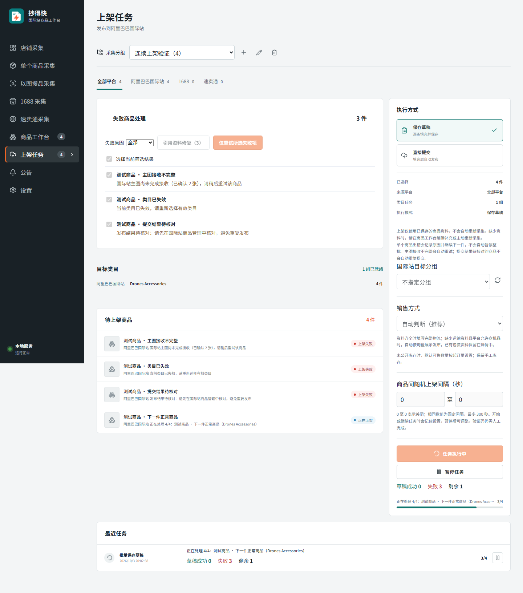

# 1.4.55 批量上架连续处理修复

日期：2026-10-03。

## 问题与修改

客户截图中的当前商品报“主图尚未完成接收（已确认 2 张）”，整批变为暂停，余下 360 件没有继续。代码将图片、控件、类目等错误统一作为环境阻塞而暂停；主图上传的局部恢复也没有处理 `MAIN_IMAGE_UPLOAD_PENDING`。

- 主图部分接收超时进入现有局部恢复流程，最多尝试三次。保留已接收图片的服务器记录，只补传缺失文件；仍在上传的文件先等待，不重复派发。成功后复核图片顺序、接收数量与上传状态，失败不能冒充成功。
- 运行中的单件图片上传、类目失效、控件、表单、平台限制和登录等错误记录到商品，推进失败数后继续下一件。不会因为错误代码里带有 `PAUSED` 就暂停整批。
- “提交结果未知”显示“发布结果待核对”，本轮不重新提交。管理员应核对国际站实际结果后，再决定是否单独重试。
- 用户点击暂停时保留当前位置、不计该件失败；继续任务不重做已完成商品。
- 阶段超时向当前发布操作传递取消信号，取消等待中的浏览器连接并关闭当前页面；晚到的进度或连接不能重启旧操作。
- 前端说明同步为单件失败后继续。人工验证码仍在现有验证窗口完成；软件授权失效、程序退出及重启时的保护和断点机制保留。

## 验证

测试使用本地样例与隔离工作区，没有登录客户账号、采集客户商品或向国际站发布真实商品。

| 检查 | 结果 |
| --- | --- |
| 最终 `npm test -- --test-concurrency=2` | 522 项，521 通过、1 失败、0 取消/跳过 |
| 未通过项独立复测：`node --test test/local-service.test.js` | 1/1 通过 |
| 主图、任务继续、间隔与浏览器连接专项 | 15/15 通过 |
| 分组、人工验证与类目错误行为调整后的专项 | 3/3 通过 |
| 本地队列与浏览器界面验证 | 通过，无页面脚本错误 |

全量唯一未通过项为既有 `local-service.test.js` 的窗口线程定时器断言：400 ms 等待期间计数 3 次，要求至少 5 次；发生在同时生成安装包期间。安装包构建完成后，不修改测试或业务代码，单独复测通过。未将最终全量结果记为一次全绿。

- `test/main-image-recovery.test.js`：Chromium 中第一次仅接收两张，第二次只接收缺失的两张；确认前两张服务器 ID 未改变、没有重复上传、顺序正确。另验证持续无回执最多三次失败。
- `test/publish-readiness-jobs.test.js`：22 类错误均记录单件失败，并继续后续商品；手动暂停不增加历史失败，恢复后正确完成。
- `test/invalid-category-refresh-api.test.js`：无效类目逐件失败；不自动采集来源，保存新类目后仅重试失败项。
- `test/human-verification-jobs.test.js`：验证码等待仍保持 running，用户主动暂停才保存断点；继续后成功。
- 进度超时与连接测试：取消信号生效、连接晚返回被丢弃、旧商品不能再推进进度。
- `node tools/publish-continuation-qa.mjs`：实际本地队列 API 配合前端，连续三件失败后第四件仍在处理；点击暂停、继续后最终成功 1 件、失败 3 件。无页面脚本错误。

下图为隔离测试数据，展示错误商品仍保留原因、下一件继续处理：

## 安装包与验证边界

此次需要更新桌面客户端，管理后台不用重复部署。正式分发使用 `chaodekuai-1.4.55-setup.exe` 和配套 `.exe.update.json`，不能分发 `inner.exe`。

构建使用本机 Electron 44.3.0。准备 Chromium 时目录占用，未强行关闭用户进程；已逐文件校验现有 Chromium 与锁定 Playwright revision 1234 缓存的 308 个文件，大小和 SHA-256 全部一致，再用于打包。

`npm run build` 通过（现有大 chunk 提示保留）。NSIS 与外层安装程序生成完成。`node tools/verify-update-package.mjs E:/CodexBuildTemp/chaodekuai-1.4.55` 核对包内 76 个模块与源码一致，版本、签名、文件大小和 SHA-256 一致，包内不含运行数据或私钥。

交付目录：`D:/抄得快安装包/1.4.55/`，包含正式 EXE、签名 JSON 和可粘贴到后台的更新说明。

- EXE 大小：267365888 字节。
- SHA-256：`9205f1460fb7b2d9b76186665d40afbb66cef0c79ecd633631daad8c457c7d84`。

没有客户实际商品或发布页面数据，因此不能确认其图片为何只接收两张；本次验证的是部分接收后的补传和整批继续行为。未执行客户现场安装覆盖，也未将安装包在生产后台正式发布。
