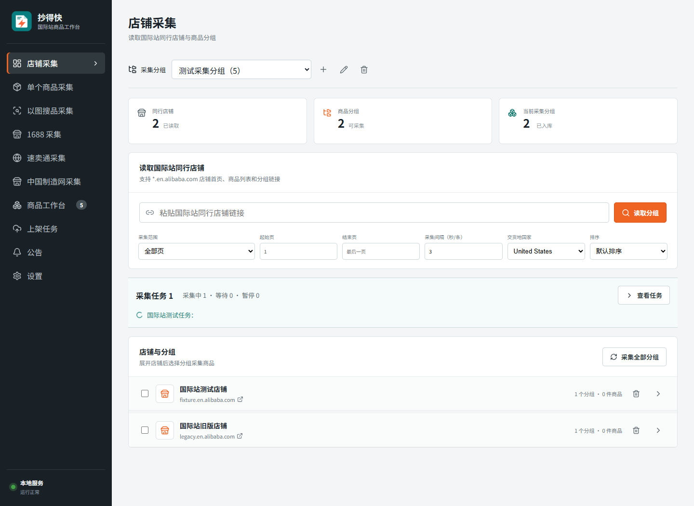
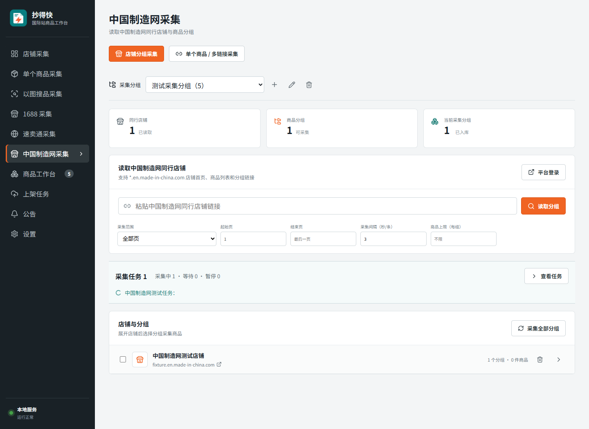

# 1.4.63 店铺采集入口修复

日期：2026-10-06。

## 问题与行为

1.4.62 的共享店铺组件误用了商品工作台的平台筛选参数。商品筛选为中国制造网时，返回“店铺采集”会显示中国制造网；首次启动时筛选默认值 `all` 也会让国际站店铺列表为空。

店铺组件现在使用独立的 `collectionPlatform`。菜单“店铺采集”固定传入 `alibaba.com`，中国制造网入口固定传入 `made-in-china`。商品工作台与上架任务继续共享商品筛选，但不再把该筛选传给采集页面。各入口的店铺、分组、统计、任务与读取请求均使用其对应平台。旧版没有记录平台的国际站店铺和任务仍可显示。

本次只调整前端参数与测试，不迁移商品数据库，也不要求重新采集已有商品。

## 验证

`node --test test/collection-navigation.test.js`：5/5 通过。用实际 React 菜单和隔离的模拟 API 验证：

- 首次打开显示国际站店铺，兼容旧版店铺记录。
- 中国制造网单件采集 → 查看商品 → 返回店铺采集，国际站入口不会改变。
- 全部平台、国际站、1688、速卖通、中国制造网筛选，往返商品工作台、上架任务和两个采集入口。
- 两个平台分别读取分组、采集全部分组，请求只包含该平台店铺和当前采集分组。
- 两个平台的店铺数量、商品数量、任务摘要和页面控件正确，React 无页面异常。

测试不访问平台商品页、不登录或发布商品、不读取客户工作区。前端构建通过；保留已有的体积提示。

使用测试店铺的页面截图：

全量 `npm test -- --test-concurrency=2` 共 567 项：566 通过，1 项取消。取消项是既有描述编辑器延迟加载测试，超过其 30 秒用例上限；发生时同时在构建安装包。本次未改描述编辑器代码，不能将该轮记录为全量通过。打包完成后独立运行 `node --test test/posting-readiness.test.js`，7/7 通过；原超时项耗时约 18.8 秒，没有修改测试超时阈值或业务逻辑。

## 安装包

使用已安装的 Electron 44.3.0（与锁定依赖一致），通过 Electron Builder 的 `electronDist` 指定本地运行时，执行既有保护与 NSIS 外层安装包构建流程。没有重新下载浏览器，也未发布远程更新。

- `node tools/desktop-package-qa.mjs release-installer` 通过：成品启动、登录窗口、图标、未登录接口鉴权、Electron 安全开关正常。
- `node tools/verify-update-package.mjs release-installer` 通过：81 个源码对应输出、版本、安装包大小与更新签名一致；构建保留 75 个加密业务模块。
- 安装包：`release-installer/chaodekuai-1.4.63-setup.exe`，269,373,952 字节。
- 更新签名：`release-installer/chaodekuai-1.4.63-setup.exe.update.json`。
- SHA-256：`cef46d6399e1eb95af816cae04deb8a2ae4d0c79fe2f2cf9c9e9c3f01a777f26`。

后台上传以上安装包和配套签名，然后正式发布。使用隔离目录验证成品，没有覆盖安装或停止用户正在运行的软件。
