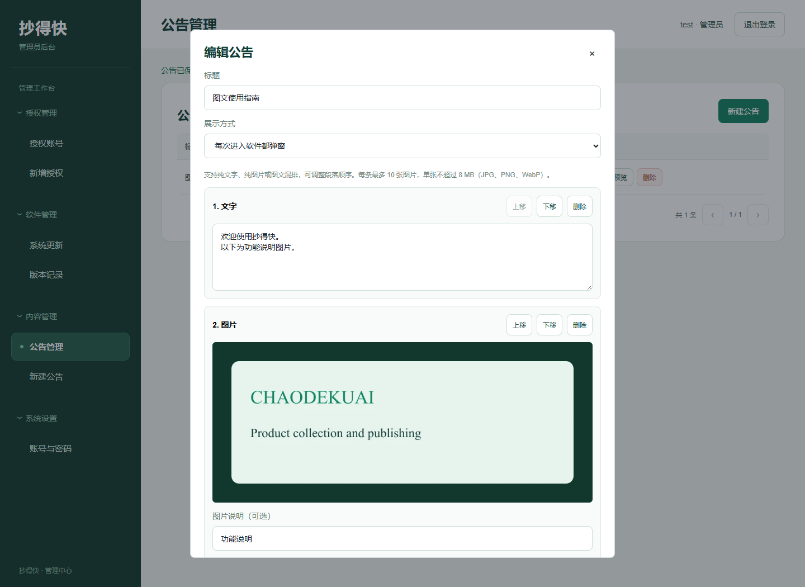
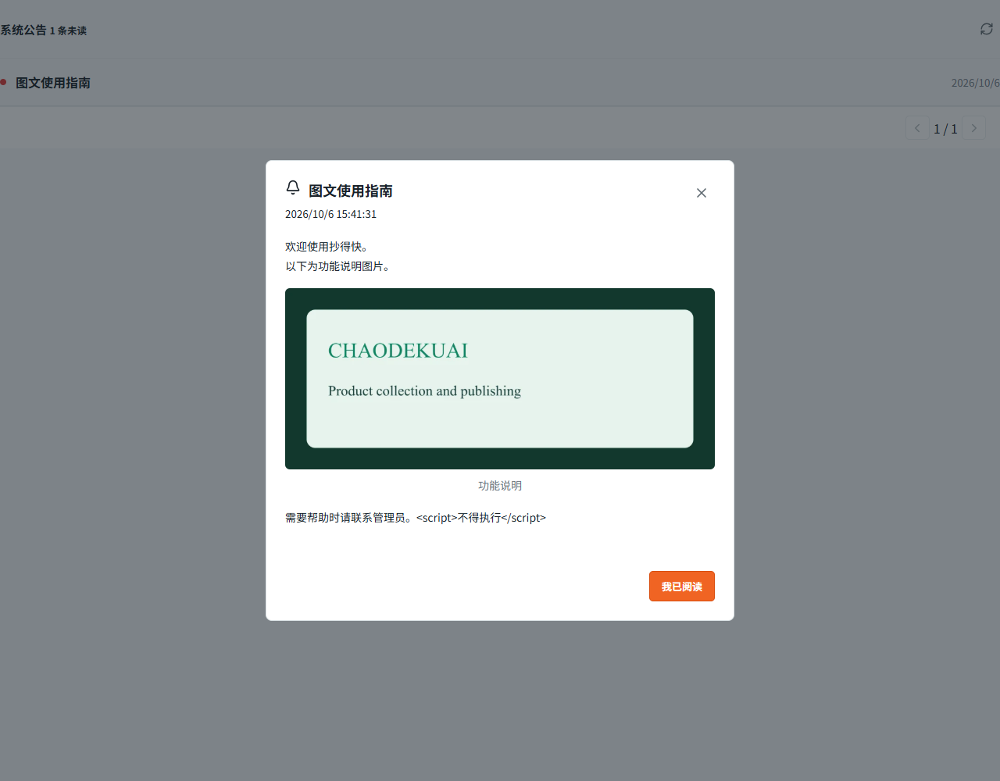
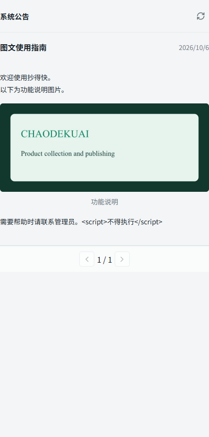

# 1.4.64 图文公告与每次进入弹窗

日期：2026-10-06。

## 行为

后台公告支持纯文字、纯图片、文字和图片交替排列。每个段落可以上移、下移、删除；图片可以填写说明。支持多图上传、保存草稿、再次编辑和预览，发布后桌面客户端的公告列表与弹窗均按保存顺序显示。

展示方式分为公告列表、弹窗一次（正文更新后再次提示）、每次进入软件都弹窗。最后一种不受旧的已读记录限制，重新进入工作台后仍提示；关闭后本次会话中的定时刷新、窗口聚焦与切换页面不会重复弹出。更新公告产生新修订号时仍会提示新版正文。

新客户端兼容旧的纯文字公告。旧客户端可继续阅读文字，并会看到图片升级提示；查看图片及每次进入弹窗需要 1.4.64 或以上客户端。

## 存储与边界

公告存储新增 `blocks` JSONB 和 `popup_policy` 两列，迁移为增量操作。图片上传接口需要管理员登录，仅接收 JPG、PNG、静态 WebP，每张最大 8 MiB、4000 万像素；经真实格式校验、去除元数据、调整到最大边长 2400 像素后保存为 WebP。文件使用内容摘要命名，原子写入。每条最多 10 张图片、40 个段落及 20000 字正文；不执行公告文字中的 HTML，不接收外部图片地址。

草稿、未关联、撤回、删除后的图片不公开；正式公告的图片可供客户端读取。同一图片仍被其他已发布公告引用时保持可读。图片单独持久化在更新目录的 `announcement-images` 子目录；目前保留未引用文件，备份时应同时保存该目录。客户端关闭公告仍使用按账号、公告 ID 和修订号保存的已读机制，会话内另外记录已关闭的重复弹窗。

## 验证

- `npm test -- --test-concurrency=2`：571/571 通过，无失败、取消或跳过。完整测试结束后才开始打包。
- `npm run build`：通过，保留现有大块体积提示。
- `node --test test/announcement-media.test.js test/auth-dev.test.js`：最后的开发预览状态读取及编辑器焦点调整后，5/5 通过。
- `node tools/announcement-media-qa.mjs`：实际管理界面上传、图文排序、私有草稿、重新编辑、预览、纯图片、空正文拒绝；实际 React 公告组件图片显示、关闭后刷新不重弹、重新打开再次弹窗、一次弹窗尊重已读及 430 像素宽屏幕均通过。测试只使用隔离服务和合成图片。
- `node tools/admin-qa.mjs`：既有管理导航、授权管理、公告弹窗入口等回归通过。
- 服务器独立 PostgreSQL 测试库依次运行 `announcement-media`、`auth-dev`、`auth-security`：全部通过，测试库均已移除，未使用客户授权或发布测试公告。

API 测试覆盖未登录上传 401、非法图片拒绝、超过限制 413、相同图片重传、未上传图片引用拒绝、草稿与撤回图片 404、发布后 200、混排顺序、已读、重启持久化和删除。

## 正式服务

已部署配套后台。备份目录 `/var/backups/kua-yipu-announcements-20261006153830` 包含源码、依赖、Nginx 配置及 PostgreSQL 备份。更新后健康检查、管理页面和两个新增模块读取正常，原管理入口保持有效；默认 `/admin/` 仍返回 404。

Nginx 仅为公告图片上传增加 8 MiB 请求限制，其他 API 限制保留；经公网 HTTPS 发送大于原通用限额的未认证请求，返回应用层 401。图片仍需登录才能上传，未发布图片返回 404。正式库现有公告保持不变，未向用户发布测试内容。服务健康接口的独立版本号仍为 1.4.53。

## 安装包

使用锁定的本地 Electron 44.3.0、现有内置 Chromium 和标准保护/NSIS 外层安装流程生成安装包。保留 75 个加密业务模块，新增共享公告模块也已包含在成品中。

- `node tools/desktop-package-qa.mjs release-installer`：通过，成品启动、登录页、未登录接口鉴权、品牌图标与 Electron 安全开关正常。
- `node tools/verify-update-package.mjs release-installer`：通过，81 个模块对应输出、两个共享模块、版本、安装包大小与更新签名一致，无运行数据或私钥入包。
- 安装包：`release-installer/chaodekuai-1.4.64-setup.exe`，269,375,488 字节。
- 更新签名：`release-installer/chaodekuai-1.4.64-setup.exe.update.json`。
- SHA-256：`aaa4a97e10e8a9f4cace8e6a30ca3e8fb4c0a72315bbc40f81377d15b3069cd0`。

此次已更新正式后台，客户端安装包与更新签名已生成供上传发布；没有自动向客户分发新客户端，也没有覆盖用户正在使用的软件和商品库。
