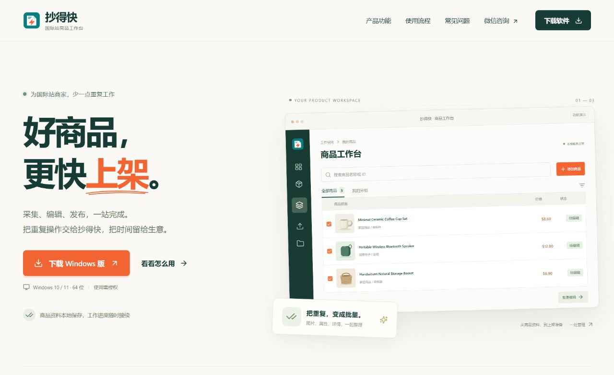

# 官网部署与验证 · 2026-10-05

官网已部署到 <https://106.55.45.126/website/>，无需域名；授权后台仍使用原有根地址。微信号 `Chen_Tao6306` 和用户提供的二维码用于咨询与授权，不显示电话。

网站包括中文产品介绍、三个可切换的功能演示、图片/模板/更新说明、使用流程、常见问题、安装指南、客户端下载和版本说明，适配桌面与手机。演示商品为明确标记的示例，不使用客户数据。

## 安装包管理

官网读取现有后台公开的 `latest.json`，展示当前正式版及更新说明。下载使用 `/updates/chaodekuai/download`，请求到达时再选择正式版本，不写死旧安装包。后台草稿不开放下载；撤回最高正式版后停止官网下载，不退回旧版。

服务器已经正式发布的版本为 **1.4.58**；本次沿用这条发布记录，没有改写历史版本或发布状态。文件为 `chaodekuai-1.4.58-setup.exe`，267,371,008 字节，SHA-256：

```text
206279adfcf7ab8dab4868749443f05a4e517f2223c3494c378052c7b7c82fa6
```

## 验证结果

- `npm run website:build` 通过。官网与桌面端构建目录分开。
- `npm test -- --test-concurrency=2`：535 / 535 通过。
- 版本联动回归测试：部分上传、已上传未发布、正式发布切换、最新版本撤回、文件名及 Range 请求。
- 官网异常元数据测试：错误平台、错误文件名、外部地址、异常版本和大小被拒绝。
- 浏览器实测：手机菜单、复制微信、二维码显示、Escape 关闭、功能标签键盘切换、FAQ 展开、后台真实版本说明。手机与桌面无横向溢出，未发现缺图或控制台报错。
- 通过本地官网实际下载 EXE，文件 SHA-256 与构建产物一致；公网检查首页/JS/二维码返回 200，下载 HEAD 返回正确名称和大小，Range 返回 206 和正确 MZ 文件头，公开版本签名验证通过。
- 未登录访问管理员更新接口仍返回 401，原后台登录页可访问。没有改写客户授权、商品或发布任务。

## 部署与回滚位置

- 当前静态产物：`/var/www/chaodekuai-website-releases/20261005113108`。
- 访问目录软链：`/var/www/chaodekuai-website`。
- 本次部署前备份：`/var/backups/chaodekuai-website-20261005113108`。
- Nginx 官网配置：`/etc/nginx/snippets/chaodekuai-website.conf`。
- 更新的后台源码：`updates.js`、`admin.html`、`admin.css`。

部署脚本先备份相关文件，配置校验通过后重启授权服务并重载 Nginx。它会等待新 worker 接管，避免把重载期间旧 worker 短暂返回的 404 当作部署失败；验证失败会自动恢复旧后台和站点配置。首次检查触发过该回滚，调整检查时机后重新部署验证通过。

后续发布软件只需在后台上传 EXE 与签名文件、填写说明并正式发布，不需要重新部署官网。网站文案或客服信息改变时才需要重新构建网站。维护说明见 [官网 README](../website/README.md)。


